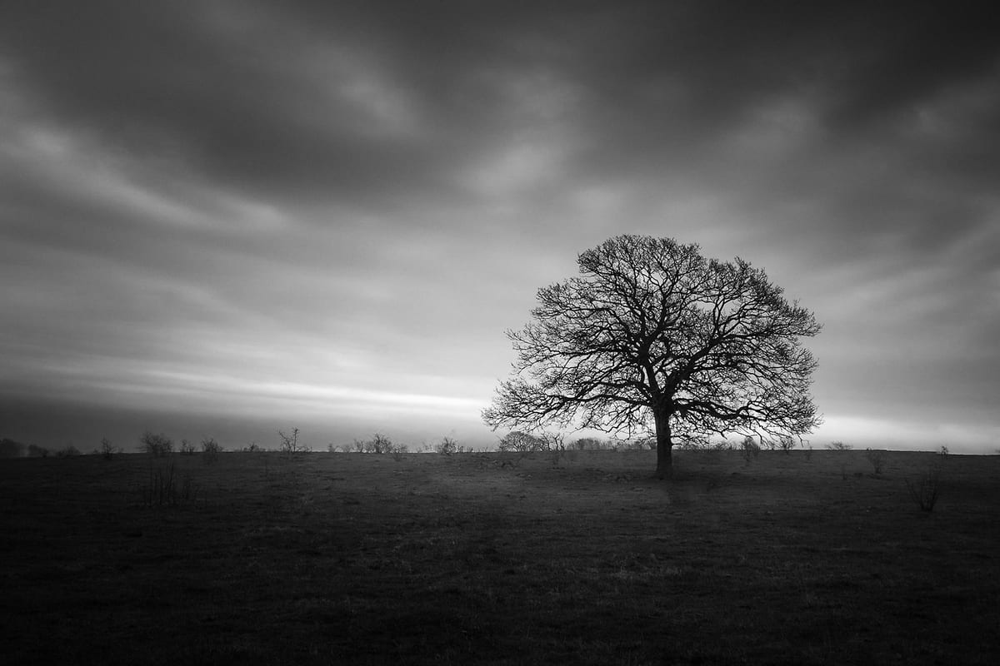
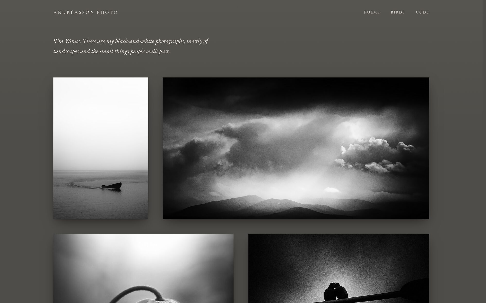
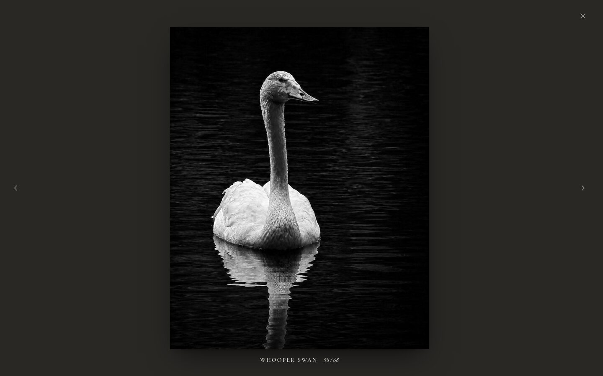
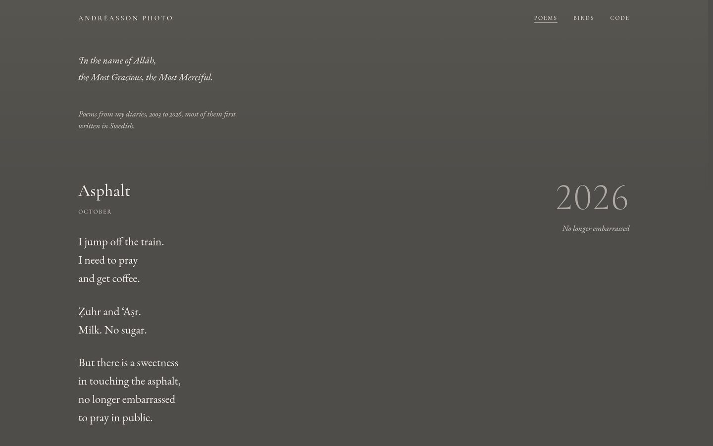
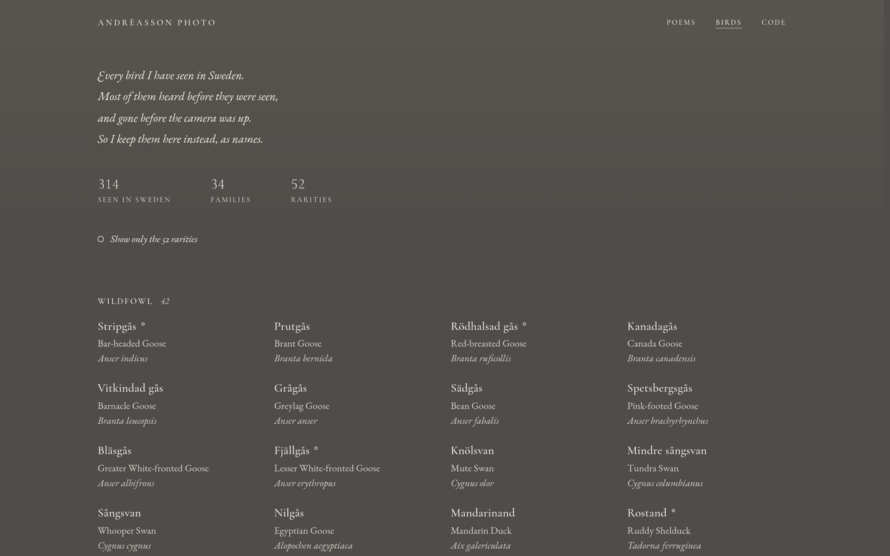
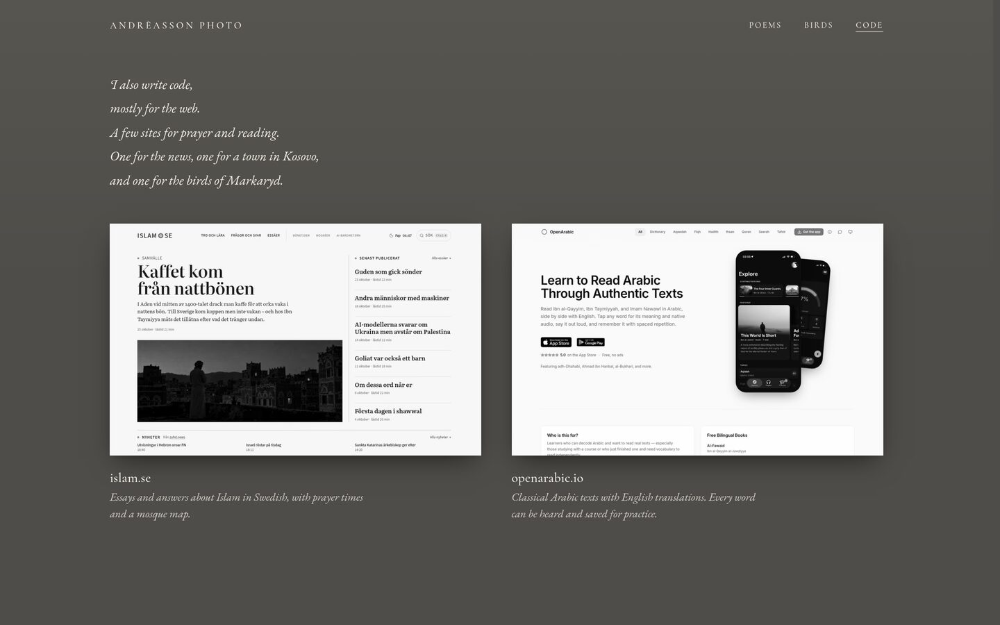

<p align="center">
  <a href="https://andreassonphoto.com">
    
  </a>
</p>

<p align="center">
  The source of andreassonphoto.com: a static Astro site on Cloudflare Pages,<br>
  with prints served as AVIF and the photographs themselves kept out of git.
</p>

<p align="center">
  <a href="https://andreassonphoto.com"><b>andreassonphoto.com</b></a> ·
  <a href="#run-it-locally">Run it locally</a> ·
  <a href="#under-the-hood">Under the hood</a> ·
  <a href="#license">License</a>
</p>

<p align="center">
  <a href="https://github.com/YunusAndreasson/andreassonphoto.com/actions/workflows/verify.yml"></a>
  <a href="LICENSE"></a>
  <a href="LICENSE"></a>
</p>

<br>



## What's on it

- **The wall.** The home page, hung by hand. Prints that share a `row` in
  `src/content/gallery/images.json` hang together as a diptych or triptych,
  a print alone on its row is a pause, and two prints with the same `order`
  fail the build rather than hang in whatever order they loaded.
- **The viewer.** Every print has its own address, such as
  [/whooper-swan/](https://andreassonphoto.com/whooper-swan/), which opens
  the wall onto it, so a shared link lands on the photograph. Prints are AVIF
  at quality 70, up to 2400 px; the encoder's default of 50 smooths away the
  grain.
- **Poems.** Pieces from the diaries, 2003 to 2026, most of them first
  written in Swedish. They're generated from a private diary repository, so
  only what's published is here, each with a page of its own.
- **Birds.** Every species seen in Sweden, 314 so far, grouped by family with
  the rarities marked. Most were gone before the camera was up, so they're
  kept as names.
- **Code.** The websites built alongside the photographs, hung as prints in
  black and white that take their colours on hover. It's the one page those
  sites link back to, so they don't each carry the list.
- **Link previews.** `scripts/make-og.mjs` draws a 1200×800 card for every
  print and poem in the site's own faces, so a shared link shows the page in
  small.

<table>
  <tr>
    <td width="50%"></td>
    <td width="50%"></td>
  </tr>
  <tr>
    <td align="center"><sub><b>The viewer</b>, Whooper Swan at its own address</sub></td>
    <td align="center"><sub><b>Poems</b>, the year hung in the margin</sub></td>
  </tr>
  <tr>
    <td width="50%"></td>
    <td width="50%"></td>
  </tr>
  <tr>
    <td align="center"><sub><b>Birds</b>, 314 species in 34 families</sub></td>
    <td align="center"><sub><b>Code</b>, the sites as prints</sub></td>
  </tr>
</table>

## Run it locally

The photographs aren't in the repository: `photos/` is ignored, and
`src/assets/gallery_bw` links into it. `pnpm stand-ins` fills every missing
print with its own link preview, so a clone builds and runs with each print in
its place, small and landscape. It never overwrites a file that's there.

```sh
git clone https://github.com/YunusAndreasson/andreassonphoto.com.git
cd andreassonphoto.com
pnpm install --frozen-lockfile
pnpm stand-ins
pnpm dev
```

Astro 7 needs Node 22.23.4 or newer; CI runs 26.13.0, with the pnpm in
`packageManager`. `pnpm verify` runs `astro check`, the tests in `tests/` and
the build, as [CI](.github/workflows/verify.yml) does, and `pnpm preview`
serves the result. Deploys are direct uploads to Cloudflare Pages with
Wrangler, from the owner's machine. Pull requests:
[CONTRIBUTING.md](CONTRIBUTING.md).

## Under the hood

- [Astro](https://astro.build), static output, with content collections for
  the prints, poems, birds and sites, and its Fonts API for self-hosted faces
- [sharp](https://sharp.pixelplumbing.com), through `astro:assets`, for the
  AVIF prints
- [Cloudflare Pages](https://pages.cloudflare.com), with headers and
  redirects in `public/_headers` and `public/_redirects`
- [@astrojs/sitemap](https://docs.astro.build/en/guides/integrations-guide/sitemap/)
  and an image sitemap from `src/pages/sitemap-images.xml.ts`
- [Cormorant Garamond](https://github.com/CatharsisFonts/Cormorant) and
  [EB Garamond](https://github.com/octaviopardo/EBGaramond12), cut down by
  `scripts/make-fonts.py` with [fontTools](https://github.com/fonttools/fonttools)
- Headless Chrome for the link previews and the screenshots on /code
- `node:test` for the page lifecycle in `src/scripts/lifecycle.ts`

## License

The code is [MIT](LICENSE). The photographs, poems, link previews and the
name Andrèasson Photo are all rights reserved, and the fonts keep the SIL
Open Font License; [LICENSE](LICENSE) names the paths.
